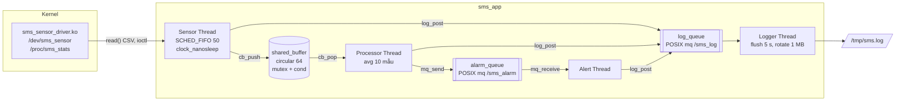

# Assignment 02 — Sensor Monitoring System (SMS)

Sinh viên: **Nguyễn Trần Quang** — MSSV **SE200988** — Embedded Linux Systems

Thư mục [`SE200988_NguyenTranQuang_Asgn02/`](SE200988_NguyenTranQuang_Asgn02/) là cây bài nộp theo mục 4.1 của đề, xem trực tiếp được trên GitHub:

| Thư mục | Nội dung |
|---|---|
| [`driver/`](SE200988_NguyenTranQuang_Asgn02/driver/) | Kernel module `sms_sensor_driver.ko`: `/dev/sms_sensor` (misc device), `/proc/sms_stats`, ioctl `SMS_SET_INTERVAL` / `SMS_GET_INTERVAL`, header dùng chung `sms_sensor.h` |
| [`app/`](SE200988_NguyenTranQuang_Asgn02/app/) | `sms_app`: 4 thread (Sensor, Processor, Alert, Logger), circular buffer, 2 POSIX message queue; binary ARM `sms_app` và x86 `sms_app_x86`; script GDB `gdb_alert.gdb` |
| [`output/`](SE200988_NguyenTranQuang_Asgn02/output/) | `initramfs_asgn2.cpio.gz` boot được trên QEMU vexpress-a9 |
| [`logs/`](SE200988_NguyenTranQuang_Asgn02/logs/) | Log kiểm thử, Valgrind, strace, perf, GDB, jitter, memory footprint |
| [`qemu/`](SE200988_NguyenTranQuang_Asgn02/qemu/) | `run_qemu.sh` và các file thêm vào rootfs (`inittab`, `rcS`, `test_sms.sh`, `jitter_test.sh`) |
| [`demo/`](SE200988_NguyenTranQuang_Asgn02/demo/) | Video demo 3–5 phút |
| [`bao_cao/`](SE200988_NguyenTranQuang_Asgn02/bao_cao/) | Báo cáo PDF |

## Kiến trúc



## Build và chạy

Kernel LAB-01 (`vexpress_defconfig`) phải bật thêm 2 option rồi build lại zImage. Cần thêm `KCFLAGS/KAFLAGS=-march=armv7-a` vì gcc 11 hard-float rơi về `-march=armv5t`:

```sh
cd ~/embedded_lab1/kernel/linux-5.15
./scripts/config --enable POSIX_MQUEUE --enable HIGH_RES_TIMERS
make ARCH=arm CROSS_COMPILE=arm-linux-gnueabihf- olddefconfig
make -j$(nproc) ARCH=arm CROSS_COMPILE=arm-linux-gnueabihf- KCFLAGS=-march=armv7-a KAFLAGS=-march=armv7-a zImage
```

Build driver và app:

```sh
cd SE200988_NguyenTranQuang_Asgn02/driver && make     # ARMv7, KDIR = kernel LAB-01
cd ../app && make                                     # make arm -> sms_app, make host -> sms_app_x86
```

Chạy trên QEMU (trong shell của QEMU):

```sh
insmod /lib/modules/5.15.0/sms_sensor_driver.ko
cat /proc/sms_stats
sms_app -v -d 60          # -i <ms> -t <C> -h <%> -d <s> -v -s fifo|other -D <dev> -L <log>
test_sms.sh               # test driver, 60 s, memory, threads, SIGINT
jitter_test.sh            # 4 lần đo jitter: FIFO/OTHER x không tải/có tải
```

## Kết quả kiểm thử

| Yêu cầu | Kết quả | Bằng chứng |
|---|---|---|
| Driver: read CSV, `/proc/sms_stats`, ioctl | Đọc đúng `<ts>,<T>,<H>`, insmod/rmmod không oops | [qemu_test_log.txt](SE200988_NguyenTranQuang_Asgn02/logs/qemu_test_log.txt) |
| 4 thread chạy song song | 5 task (main + 4), `sms_sensor` là SCHED_FIFO prio 50 | [memory_footprint.txt](SE200988_NguyenTranQuang_Asgn02/logs/memory_footprint.txt) |
| Chạy 60 s, interval 500 ms → read_count ≈ 120 | before 0 → during 60 → after **120** | [before](SE200988_NguyenTranQuang_Asgn02/logs/proc_sms_stats_before.txt) · [during](SE200988_NguyenTranQuang_Asgn02/logs/proc_sms_stats_during.txt) · [after](SE200988_NguyenTranQuang_Asgn02/logs/proc_sms_stats_after.txt) |
| Log file có entry từ mọi thread | `[logger] [sensor] [processor] [alert] [main]` | [sms.log](SE200988_NguyenTranQuang_Asgn02/logs/sms.log) |
| Graceful shutdown SIGINT, exit code | SIGINT → join 4 thread, flush log, exit 0; tham số sai → 1; không có thiết bị → 2 | [sms_sample_run.txt](SE200988_NguyenTranQuang_Asgn02/logs/sms_sample_run.txt) · [qemu_test_log.txt](SE200988_NguyenTranQuang_Asgn02/logs/qemu_test_log.txt) |
| Valgrind 0 bytes definitely lost | 0 bytes in use at exit, All heap blocks were freed, 0 errors, 3 fd (std) | [valgrind_sms.txt](SE200988_NguyenTranQuang_Asgn02/logs/valgrind_sms.txt) |
| Memory footprint T=5/30/55 s | VmRSS 1752 kB tại T=5 s; bảng 3 thời điểm và `/proc/PID/maps` | [memory_footprint.txt](SE200988_NguyenTranQuang_Asgn02/logs/memory_footprint.txt) |
| GDB kịch bản B | `set variable temperature = 45.0` → Alert Thread nhận TEMP_HIGH, `counts` {0,0,0} → {1,0,0} | [gdb_session.txt](SE200988_NguyenTranQuang_Asgn02/logs/gdb_session.txt) |
| strace -c 30 s | Top: mq_timedreceive 75, rt_sigtimedwait 30, futex 230, clock_nanosleep 61, mq_timedsend 75 | [strace_sms.txt](SE200988_NguyenTranQuang_Asgn02/logs/strace_sms.txt) |
| perf hotspot | `__vfscanf_internal` (sscanf parse CSV) 5.2 %, `snprintf` của Logger 4.8 % | [perf_sms.txt](SE200988_NguyenTranQuang_Asgn02/logs/perf_sms.txt) |
| Build không warning `-Wall -Wextra` | Không có warning (gcc 11.4, ARM và x86) | — |

### Jitter Sensor Thread (chu kỳ 10 ms, ~1500 mẫu/lần, QEMU TCG)

| Lần chạy | Min | Avg | Max | P99 |
|---|---:|---:|---:|---:|
| SCHED_FIFO, không tải | 91 µs | 442.7 µs | 892 µs | 684 µs |
| SCHED_OTHER, không tải | 182 µs | 492.8 µs | 1021 µs | 725 µs |
| SCHED_FIFO, 4 vòng lặp chiếm CPU | 78 µs | 127.7 µs | 2103 µs | 185 µs |
| SCHED_OTHER, 4 vòng lặp chiếm CPU | 136 µs | 161.0 µs | 342 µs | 248 µs |

Histogram từng lần: [jitter_report.txt](SE200988_NguyenTranQuang_Asgn02/logs/jitter_report.txt).

## Ghi chú

- `sms_app_x86` dùng bộ mô phỏng trong app (`-D sim`) thay cho driver, vì driver ARM không nạp được vào kernel Ubuntu. Toàn bộ code thread, buffer, message queue và logger giống hệt bản ARM. Valgrind, strace, perf, GDB chạy trên bản này.
- Driver cho phép đọc sớm hơn `interval` tối đa 10 % để bù jitter của thread userspace; sớm hơn nữa thì trả `-EAGAIN` (fd `O_NONBLOCK`) hoặc ngủ cho đủ (fd blocking).
- Số liệu jitter đo trên QEMU TCG, không phải phần cứng thật, nên có các mẫu vọt lên vài ms do host không real-time.
