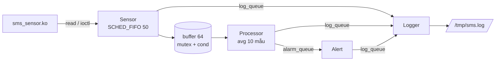

# Assignment 02 — Sensor Monitoring System (SMS)

Hệ thống giám sát cảm biến chạy trên ARMv7 (QEMU vexpress-a9, kernel 5.15). Kernel module giả lập cảm biến nhiệt độ/độ ẩm; ứng dụng dùng 4 thread để đọc dữ liệu, tính trung bình, phát cảnh báo và ghi log.

## Cấu trúc

```
SE200988_NguyenTranQuang_Asgn02/
├── driver/   kernel module: /dev/sms_sensor, /proc/sms_stats, ioctl SMS_SET_INTERVAL
├── app/      sms_app: sensor, processor, alert, logger thread + circular buffer
├── qemu/     run_qemu.sh, rcS, test_sms.sh, jitter_test.sh
├── output/   initramfs_asgn2.cpio.gz
├── logs/     log chạy trên QEMU và Ubuntu x86
├── demo/     video demo
└── bao_cao/  báo cáo PDF
```



## Build và chạy

Kernel cần bật `CONFIG_POSIX_MQUEUE`.

```sh
cd Assignment-2/SE200988_NguyenTranQuang_Asgn02
make -C driver && make -C app
./qemu/run_qemu.sh            # vào shell QEMU
./qemu/run_qemu.sh autotest   # tự chạy test rồi tắt máy
```

Trong QEMU: `insmod /lib/modules/5.15.0/sms_sensor_driver.ko` rồi `sms_app -v -d 60`.
Trên x86 (Valgrind, strace, perf, GDB): `./app/sms_app_x86 -D sim`.

## Kết quả

| Yêu cầu | Kết quả |
|---|---|
| Driver | Đọc ra `<ts>,<T>,<H>`, đọc quá sớm trả `EAGAIN`, insmod/rmmod không oops |
| 60 s, interval 500 ms | read_count 0 → 59 → **120**, 5 task, sensor SCHED_FIFO 50 |
| Shutdown | Ctrl+C → exit 0; sai tham số → 1; không có thiết bị → 2 |
| Valgrind | 0 bytes in use at exit, 0 errors |
| Memory | VmRSS 1748 kB ở T=5/30/55 s, không tăng |
| GDB | `set variable temperature = 45.0` → alert_count {0,0,0} → {1,0,0} |
| strace | Nhiều nhất: mq_timedreceive, clock_nanosleep, futex → ứng dụng chủ yếu chờ, không CPU-bound |
| perf | Tốn nhất: định dạng số thực khi ghi log (`__printf_fp_l` 4.55 %) |

Jitter Sensor Thread (chu kỳ 10 ms, ~1500 mẫu):

| | Avg | Max | P99 |
|---|---:|---:|---:|
| FIFO, không tải | 577.5 µs | 1816 µs | 805 µs |
| OTHER, không tải | 587.9 µs | 1547 µs | 808 µs |
| FIFO, có tải | 144.6 µs | 1812 µs | 285 µs |
| OTHER, có tải | 201.3 µs | 2503 µs | 382 µs |

Khi có tải, SCHED_FIFO giảm P99 khoảng 25 %. Max vẫn 1.5–2.5 ms vì QEMU chạy trên host không real-time; muốn giảm thêm cần PREEMPT_RT, `isolcpus` và đo trên phần cứng thật.

Chi tiết trong thư mục [logs/](SE200988_NguyenTranQuang_Asgn02/logs/).


