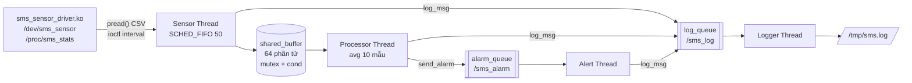

# Assignment 02 — Sensor Monitoring System (SMS)

Sinh viên: **Nguyễn Trần Quang** — MSSV **SE200988** — Embedded Linux Systems

Bản ASSIGNMENT-02

- Driver theo đúng mẫu **LAB-02** (`register_chrdev` + `class_create/device_create` + `proc_create/seq_file`) và **ASSIGNMENT-01** (`unlocked_ioctl`, `copy_from_user`, `mutex`).
- App dùng pthread, 1 mutex + 1 condition variable cho buffer, 2 POSIX message queue. Không có struct context, không có callback, không có thread phụ.

## Cây thư mục

```
SE200988_NguyenTranQuang_Asgn02/
├── driver/  sms_sensor_driver.c, sms_sensor.h (ioctl), Makefile, sms_sensor_driver.ko
├── app/     sms_app.c            main: tham số, tạo/dừng thread, tổng kết
│            sensor_thread.c      đọc driver, SCHED_FIFO, đo jitter
│            processor_thread.c   trung bình 10 mẫu, phát hiện bất thường
│            alert_thread.c       alarm_queue + in cảnh báo
│            logger_thread.c      log_queue + ghi file, flush 5 s, rotate 1 MB
│            circular_buffer.c    shared_buffer 64 phần tử (mutex + cond)
│            sms.h                struct + prototype dùng chung
│            gdb_alert.gdb        script GDB kịch bản B
│            Makefile             make arm / make host
│            sms_app (ARM), sms_app_x86 (x86, dùng với -D sim)
├── qemu/    run_qemu.sh + rootfs_overlay (rcS, inittab, test_sms.sh, jitter_test.sh)
├── output/  initramfs_asgn2.cpio.gz
├── logs/    log thật từ QEMU và x86 (xem bảng kết quả)
├── demo/    video demo
└── bao_cao/ báo cáo PDF
```

## Kiến trúc



Trạng thái của `main`: **INIT** (đọc tham số, mở driver, tạo buffer/queue/log) → **RUNNING** (4 thread chạy, main ngủ từng giây) → **SHUTDOWN** (hết `-d` giây hoặc Ctrl+C).

Thứ tự dừng đi theo chiều dữ liệu, nên không mất dữ liệu ở giữa:
1. `running = 0` → Sensor Thread thoát vòng lặp → join.
2. `cb_stop()` → Processor xử lý nốt mẫu còn trong buffer rồi thoát → join.
3. Gửi `ALARM_STOP` vào alarm_queue → Alert thoát → join.
4. Gửi message rỗng vào log_queue → Logger ghi hết log, flush → join. Sau đó đóng file, đóng/xóa queue, `free` buffer, `close` fd driver.

## Build và chạy

Kernel LAB-01 phải bật `CONFIG_POSIX_MQUEUE` (message queue) rồi build lại zImage:

```sh
cd ~/embedded_lab1/kernel/linux-5.15
./scripts/config --enable POSIX_MQUEUE --enable HIGH_RES_TIMERS
make ARCH=arm CROSS_COMPILE=arm-linux-gnueabihf- olddefconfig
make -j$(nproc) ARCH=arm CROSS_COMPILE=arm-linux-gnueabihf- KCFLAGS=-march=armv7-a KAFLAGS=-march=armv7-a zImage
```

Build driver và app, rồi boot QEMU:

```sh
cd Assignment-2/SE200988_NguyenTranQuang_Asgn02
make -C driver                 # KDIR mặc định ~/embedded_lab1/kernel/linux-5.15
make -C app                    # make arm -> sms_app, make host -> sms_app_x86
./qemu/run_qemu.sh             # vào shell QEMU
./qemu/run_qemu.sh autotest    # tự chạy test_sms.sh + jitter_test.sh rồi tắt máy
```

`run_qemu.sh` lấy busybox và dtb từ thư mục `Lab01/` của repo.

Trong shell QEMU:

```sh
insmod /lib/modules/5.15.0/sms_sensor_driver.ko
cat /dev/sms_sensor ; cat /proc/sms_stats
sms_app -v -d 60        # -i <ms> -t <C> -h <%> -d <s> -v -s fifo|other -D <dev> -L <log>
```

Trên PC (x86) không có driver ARM, nên chạy `./sms_app_x86 -D sim`: Sensor Thread tự sinh số liệu giống driver, phần còn lại của app giống hệt bản ARM.

## Kết quả

| Yêu cầu | Kết quả | File |
|---|---|---|
| Driver: read CSV, `/proc/sms_stats`, ioctl | Đọc ra `<ts>,<T>,<H>`; đọc quá sớm trả `EAGAIN`; insmod/rmmod không oops | [qemu_test_log.txt](SE200988_NguyenTranQuang_Asgn02/logs/qemu_test_log.txt) |
| 4 thread song song | 5 task (main + 4), `sms_sensor` SCHED_FIFO prio 50 | [memory_footprint.txt](SE200988_NguyenTranQuang_Asgn02/logs/memory_footprint.txt) |
| 60 s, interval 500 ms → read_count ≈ 120 | 0 → 58 (T=30 s) → **120** | [before](SE200988_NguyenTranQuang_Asgn02/logs/proc_sms_stats_before.txt) · [during](SE200988_NguyenTranQuang_Asgn02/logs/proc_sms_stats_during.txt) · [after](SE200988_NguyenTranQuang_Asgn02/logs/proc_sms_stats_after.txt) |
| Log có entry của mọi thread | `[main] [sensor] [processor] [alert]`, Logger ghi timestamp | [sms.log](SE200988_NguyenTranQuang_Asgn02/logs/sms.log) |
| SIGINT + exit code | Ctrl+C → exit 0, /dev/mqueue rỗng; sai tham số → 1; không có thiết bị → 2 | [sms_sample_run.txt](SE200988_NguyenTranQuang_Asgn02/logs/sms_sample_run.txt) |
| Valgrind 35 s rồi SIGINT | 0 bytes in use at exit, 0 errors, 3 fd (std) | [valgrind_sms.txt](SE200988_NguyenTranQuang_Asgn02/logs/valgrind_sms.txt) |
| Memory T=5/30/55 s | VmRSS 1736 / 1736 / 1736 kB | [memory_footprint.txt](SE200988_NguyenTranQuang_Asgn02/logs/memory_footprint.txt) |
| GDB kịch bản B | `set variable temperature = 45.0` → Alert nhận TEMP_HIGH, `alert_count` {0,0,0} → {1,0,0} | [gdb_session.txt](SE200988_NguyenTranQuang_Asgn02/logs/gdb_session.txt) |
| strace -c 30 s | mq_timedreceive, clock_nanosleep, futex, mq_timedsend, lseek | [strace_sms.txt](SE200988_NguyenTranQuang_Asgn02/logs/strace_sms.txt) |
| perf | ~51 % thời gian ở scheduler kernel; user-space tốn nhất: `strftime`, `printf` float | [perf_sms.txt](SE200988_NguyenTranQuang_Asgn02/logs/perf_sms.txt) |
| `-Wall -Wextra` | Không warning (gcc 13, ARM và x86) | — |

### Jitter Sensor Thread (QEMU TCG, chu kỳ 10 ms, ~1500 mẫu/lần)

| Lần chạy | Min | Avg | Max | P99 | >1 ms |
|---|---:|---:|---:|---:|---:|
| SCHED_FIFO, không tải | 168 µs | 442.8 µs | 4846 µs | 2555 µs | 31 |
| SCHED_OTHER, không tải | 292 µs | 487.9 µs | 6541 µs | 2343 µs | 34 |
| SCHED_FIFO, 2 vòng lặp chiếm CPU | 180 µs | 463.1 µs | 24277 µs | 4375 µs | 92 |
| SCHED_OTHER, 2 vòng lặp chiếm CPU | 229 µs | 405.7 µs | 5840 µs | 3733 µs | 65 |

Histogram đầy đủ: [jitter_report.txt](SE200988_NguyenTranQuang_Asgn02/logs/jitter_report.txt).

## Ghi chú

**Đồng bộ và deadlock.** App chỉ có **1 mutex** (`shared_buffer.lock`). Không chỗ nào giữ 2 lock cùng lúc, nên không có vòng chờ → không deadlock. Hai queue do kernel tự đồng bộ. Các biến dùng chung khác:
- `running`: kiểu `volatile sig_atomic_t`, chỉ signal handler và main ghi.
- `dropped_logs`: nhiều thread cùng tăng → dùng `__atomic_fetch_add`.
- `alert_count[]`, mảng jitter: chỉ 1 thread ghi; main chỉ đọc **sau khi join** thread đó.
- Driver: 1 mutex `sms_lock`; `copy_to_user` gọi sau khi đã unlock.

**Lỗi ** Valgrind báo `mq_timedsend(msg_ptr) points to uninitialised byte(s)`: struct `Alarm` có 4 byte đệm giữa `int type` và `long long ts_ms`, gửi qua queue là gửi cả byte rác. Sửa bằng `memset` trước khi gán field (`alert_thread.c`).

**Vì sao chọn như vậy.**
- Circular buffer: cấp phát 1 lần, không `malloc` mỗi mẫu, nên không phân mảnh heap và không leak. Linked list thì mỗi mẫu phải malloc/free.
- POSIX mq cho alarm: kernel lo việc chặn/đánh thức, không cần tự viết lock như shared memory.
- Logger tách riêng: ghi file chậm và có thể bị chặn. Gửi log bằng `mq_send` kiểu `O_NONBLOCK`, nên Sensor Thread không bao giờ bị chặn vì ghi log; queue đầy thì bỏ log và tăng `dropped_logs`.

**Memory.** RSS không đổi ở 3 thời điểm vì mọi bộ nhớ cấp phát lúc khởi động. Mảng jitter là mảng tĩnh, buffer malloc 1 lần. `VmLck ≈ VmSize` vì có `mlockall`. Trong `maps`:
- `r-xp sms_app` là text.
- `r--p` là rodata, `rw-p` là data/bss.
- `[heap]`.
- 4 vùng `rw-p` 256 KB kèm trang `---p` 4 KB là stack + guard page của 4 thread.
- Vùng 1 MB `76d00000` là malloc arena của thread.
- `[stack]` của main, `[vdso]`, `[vectors]`.
- Không có thư viện `.so` vì binary ARM link `-static`.

**strace.** `mq_timedreceive`: Logger và Alert chờ queue (glibc cài `mq_receive` bằng syscall này). `clock_nanosleep`: chu kỳ Sensor + `sleep(1)` của main. `futex`: mutex/cond của buffer. `mq_timedsend`: `log_msg` và `send_alarm`. `lseek`: do `ftell()` của Logger, mỗi dòng log gọi 1 lần (có thể tự cộng số byte để bỏ syscall này). Trên QEMU còn có `pread64` đọc driver; bản x86 `-D sim` không có. App thiên về chờ I/O và sleep, không phải CPU-bound.

**perf.** Phần lớn mẫu nằm trong scheduler kernel (ngủ/thức), đúng với app chờ là chính. Trong user-space, tốn nhất là `strftime` (Logger format thời gian cho mỗi dòng) và `printf` số thực. Có thể cải tiến bằng cách chỉ gọi `strftime` 1 lần mỗi giây, rồi ghép thêm phần mili giây.

**Jitter.** Trên QEMU TCG, SCHED_FIFO không cho kết quả tốt hơn rõ rệt: P99 không tải 2555 µs so với 2343 µs, có tải 4375 µs so với 3733 µs. Lý do: CPU ARM ảo là thread trên máy host, nên độ ưu tiên trong máy ảo không ảnh hưởng tới việc host chia CPU. Thêm vào đó kernel cấu hình `PREEMPT_NONE`. Với chu kỳ 500 ms, jitter vài ms (< 1 % chu kỳ) vẫn chấp nhận được. Muốn giảm thêm thì dùng kernel PREEMPT_RT, `isolcpus` dành riêng 1 CPU cho Sensor Thread, và đặt IRQ affinity sang CPU khác. Phải đo trên board thật mới thấy rõ hiệu quả.

**EAGAIN.** Driver trả `EAGAIN` nếu 2 lần đọc cách nhau dưới 90 % interval. Ở chu kỳ 10 ms, một lần thức dậy trễ vài ms sẽ làm lần đọc sau đến sớm, nên Sensor Thread ghi log "driver not ready" và bỏ chu kỳ đó. Vì vậy `produced` (~1430–1480) nhỏ hơn số mẫu jitter (1501).
